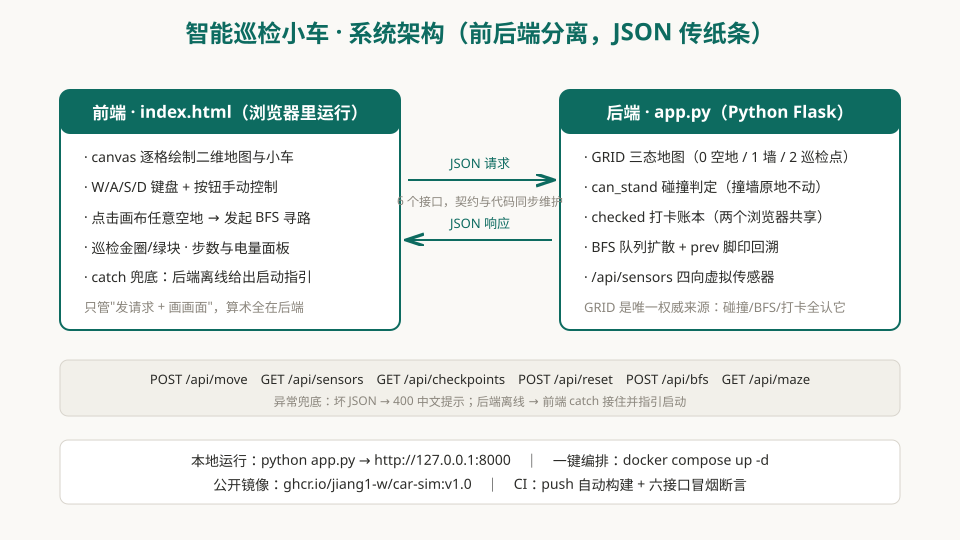

# 智能巡检小车 · 二维仿真系统

人工智能协会培训班结课项目「基于 Web 的智能巡检机器人二维仿真系统」——在浏览器里打开一张二维巡检地图：手动开车、BFS 自动寻路、巡检打卡、虚拟传感器与电量反馈，异常情况全程有兜底提示。

> 🌐 **在线演示**：待工作组统一部署后填入访问地址
> 🐳 **Docker 镜像**：`ghcr.io/jiang1-w/car-sim:v1.0`（拉取即用）

[](https://github.com/jiang1-w/git-example/actions/workflows/ci.yml)

## 30 秒跑起来

```bash
docker run -d -p 8000:8000 ghcr.io/jiang1-w/car-sim:v1.0
# 浏览器打开 http://localhost:8000
```

本地开发（或一键编排）：

```bash
cd 小车
pip install -r requirements.txt
python app.py        # 或者：docker compose up -d
```

## 系统架构



## 项目里有什么

| 路径 | 内容 |
|---|---|
| `小车/` | **项目本体**：app.py（后端）+ index.html（前端）+ Dockerfile / docker-compose + README（完整接口文档与运行说明） |
| `小车/docs/架构图.svg` | 系统架构图 |
| `小车/docs/项目汇报.pptx` | 成果展示材料（22 页阶段性汇报） |
| `小车/tests/smoke_test.py` | CI 用的六接口冒烟测试 |
| `members/` | 课程 Git 练习档案（结课项目本体在 `小车/`） |

## 成员分工

- **jiang1-w**：后端控制与状态层——地图与碰撞检查、手动控制/巡检打卡/虚拟传感器/重置接口、部署配置（Docker/Compose/CI）与文档
- **zile7**：前端全部（index.html——界面、手动控制交互、状态面板、寻路可视化、自动巡检）+ BFS 最短路径算法（后端）

AI 辅助编程：代码审查与调试定位（策划书允许，关键逻辑均经人工理解与实测验证）。小组协作采用共享分支 + 先审后并、改动留痕告知。
